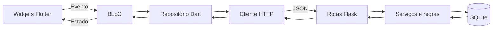

# HabitQuest — análise e planejamento

Data: 18/11/2026. Público: equipe de desenvolvimento e avaliador do projeto acadêmico.

Este documento registra o plano original. Consulte o [README](../README.md) para executar a implementação e o [roteiro de defesa](APRESENTACAO.md) para ver as rotas e os arquivos atuais.

## 1. Objetivo e limites desta entrega

Planejar uma nova aplicação Flutter de controle de hábitos e uma API própria, usando a referência fornecida para orientar a estrutura didática da integração. Este documento define a aplicação a construir; não apresenta funcionalidades planejadas como já implementadas.

**Finalidade:** ajudar pessoas que têm dificuldade de manter uma rotina a transformar pequenas ações em hábitos observáveis, com registro diário, frequência semanal e recompensas claras.

**Proposta:** HabitQuest, uma jornada de pequenas missões pessoais. Exemplo: criar “Ler por 20 minutos”, estabelecer cinco realizações na semana, registrar os dias cumpridos e acompanhar XP, nível e conquista da meta.

Requisitos confirmados pelo pedido:

- Aplicação nova em Flutter e API desenvolvida do zero.
- Criar hábitos, registrar realizações diárias e acompanhar frequência.
- Gamificação inspirada no Duolingo, com recompensas por frequência e metas.
- Paleta moderna e interface interativa.
- Cobrir os cinco itens da avaliação: finalidade, API, explicação de endpoint, integração Flutter e demonstração/defesa.
- BLoC pode ser usado; este planejamento o adota para tornar estados e responsabilidades explícitos.

Premissas de planejamento, passíveis de ajuste antes da implementação:

- Android será a plataforma principal da demonstração. Flutter Web será alternativa se validado com a API.
- MVP acadêmico local, com um perfil único e sem login. Não será disponibilizado na internet com dados pessoais nesta configuração.
- Fuso do perfil: `America/Sao_Paulo`, fixo no MVP. A API determina o dia válido.
- Hábitos binários: uma realização por dia; “beber oito copos” será o nome de uma missão, sem oito registros parciais.
- Meta de uma a sete realizações por semana, contando dias distintos, de segunda a domingo.
- Não há prazo, tamanho de equipe ou rubrica adicional informados. As estimativas são de esforço, não compromisso de calendário.

Ficam para evolução: múltiplos usuários, autenticação, ranking, loja, notificações push, sincronização offline, metas quantitativas, integração com sensores e publicação nas lojas. Não são necessários para demonstrar o fluxo acadêmico pedido.

## 2. Análise da referência e do ambiente

Fonte examinada em modo de leitura: `atividadedsdm.zip`. O arquivo original não foi alterado, extraído integralmente nem executado. Texto e código do ZIP foram tratados como referência, sem ampliar permissões ou substituir os requisitos do pedido.

| Evidência no ZIP | Comportamento observado | Aplicação no novo projeto |
| --- | --- | --- |
| `atividadedsdm/api_produtos/api.py` | Flask, lista em memória, `GET /produtos`, `jsonify`, porta 5000 | Manter a didática das rotas Flask; criar domínio de hábitos e banco persistente |
| `produtos_app/lib/produto.dart` | Modelo Dart com `fromJson` | Criar modelos próprios de hábito, realização e progresso |
| `produtos_app/lib/produto_repository.dart` | Cliente `http`, GET, validação de status e da lista JSON | Usar repositório, cliente injetável e erros tipados |
| `produtos_app/lib/main.dart` | `StatefulWidget`, carregamento, falha e lista de produtos | Substituir pelo novo aplicativo com telas e estados BLoC |
| `produtos_app/test/produto_repository_test.dart` | Testes de sucesso, erro HTTP e formato inválido | Preservar essa estratégia nos novos contratos |
| `produtos_app/test/widget_test.dart` | Teste inicial da tela e botão | Ampliar para interações e estados do HabitQuest |
| `atividadedsdm/README.md` | Execução da API, Flutter e caminho dos dados | Preparar instruções equivalentes e roteiro para a defesa |

A referência não implementa criação, edição, histórico, banco ou gamificação. Não será suficiente trocar nomes e cores: o novo domínio exige validação, persistência e regras no servidor.

O `pubspec.yaml` da referência declara Dart `^3.12.2`, `http ^1.6.0` e `flutter_lints ^6.0.0`. Isso descreve a referência, não prova compatibilidade da futura aplicação. O ambiente possui comandos Flutter/Dart e Python 3.12.10; a versão do SDK Flutter e a resolução dos pacotes deverão ser verificadas na primeira etapa. O repositório estava vazio, sem commits ou aplicação preexistente na inspeção inicial.

Não copiar `.dart_tool`, `build`, `.gradle`, `__pycache__`, caminhos de SDK ou arquivos gerados do ZIP. Criar projeto Flutter novo e ambiente Python próprio.

## 3. Escopo funcional e critérios de aceite

| ID | Funcionalidade | Resultado observável esperado |
| --- | --- | --- |
| RF01 | Criar hábito | Nome, descrição opcional, ícone, cor e meta semanal válidos ficam persistidos e aparecem em Hoje |
| RF02 | Consultar e editar | Listagem e detalhe exibem dados reais; edição de nome, descrição, cor e ícone persiste |
| RF03 | Arquivar | Hábito sai da lista ativa, mas seu histórico e recompensas permanecem consultáveis |
| RF04 | Registrar realização | Um toque registra hoje na API; o card muda apenas após confirmação |
| RF05 | Evitar duplicidade | Toques repetidos, requisições simultâneas e repetição após timeout não criam outro registro nem XP extra |
| RF06 | Acompanhar frequência | Calendário e contador mostram dias realizados e progresso da semana |
| RF07 | Premiar | Realização concede XP; meta semanal concede bônus uma vez; conquistas mostram marcos atingidos |
| RF08 | Persistir | Reiniciar API e aplicativo preserva hábitos, registros e progresso |
| RF09 | Tratar falhas | Carregamento, vazio, validação, indisponibilidade e tentar novamente são visíveis e compreensíveis |
| RF10 | Demonstrar integração | Criar e concluir no Flutter produz dados recuperáveis pela API e pelo aplicativo após reabrir |

No MVP, não editar meta de um hábito existente: uma meta nova exige arquivar o hábito e criar outro. Isso mantém a leitura histórica e os bônus coerentes sem introduzir versionamento de metas. Não oferecer exclusão de realizações ou lançamentos retroativos nesta primeira versão; essa limitação deve aparecer no formulário e na defesa.

## 4. Arquitetura proposta

Escolha: **Flutter + BLoC + pacote http → API REST Flask → SQLite**. Um único serviço, sem microsserviços, filas ou serviços pagos.

| Decisão | Motivo | Alternativa e quando reconsiderar |
| --- | --- | --- |
| Flask | Aproximação direta com a referência recebida e fluxo de endpoint fácil de explicar | FastAPI se houver exigência de outro framework ou geração automática de contrato como prioridade |
| SQLite com `sqlite3` | Persistência local sem administrar servidor de banco | PostgreSQL se houver hospedagem com múltiplas instâncias ou maior concorrência de escrita |
| BLoC por funcionalidade | Eventos, estados e efeitos tornam a integração demonstrável e testável | Simplificar a quantidade de blocos se responsabilidades ficarem pequenas |
| Perfil local único | Prioriza requisitos explicitamente pedidos e reduz dependências na demonstração | Autenticação e isolamento por usuário antes de acesso público ou uso compartilhado |

A separação de apresentação, lógica e dados segue a [arquitetura do BLoC](https://bloclibrary.dev/architecture/). Repositórios isolam o acesso aos dados conforme o [guia de arquitetura Flutter](https://docs.flutter.dev/app-architecture/guide). SQLite atende ao porte local proposto e possui integração pela biblioteca padrão Python, como demonstra o [tutorial oficial do Flask](https://flask.palletsprojects.com/en/stable/tutorial/database/).



Responsabilidades: widgets apresentam e coletam entradas; BLoC coordena eventos e estados; repositórios convertem contratos; API valida entradas e calcula recompensas; banco garante persistência e unicidade. Flutter não calcula nem envia XP autorizado pelo cliente.

Estrutura futura sugerida; os diretórios abaixo ainda não existem:

```text
habitquest/
  api/
    app/
      __init__.py            # create_app e configuração
      db.py                  # conexão por requisição e transações
      routes/                # health, habits, checkins, progress
      services/              # registros, frequência e recompensas
      repositories/          # SQL parametrizado
      validation.py
    migrations/              # esquema inicial e versões seguintes
    tests/
    requirements.txt
  mobile/
    lib/
      main.dart
      app/                   # composição, tema e navegação
      core/network/          # cliente, configuração e falhas
      features/
        habits/              # data/models, data/repositories, bloc, views
        progress/            # modelos, repositório, bloc e telas
    test/
    integration_test/
  docs/
    PLANEJAMENTO.md
```

Não criar uma classe de caso de uso para cada chamada HTTP sem necessidade. Regras de premiação ficam no servidor; blocos não devem depender diretamente de outros blocos. Após uma mutação, a camada de composição coordena a atualização dos dados afetados.

## 5. Modelo de dados e consistência

| Entidade | Campos principais | Restrições |
| --- | --- | --- |
| `profile` | `id`, `display_name`, `timezone` | Um perfil no MVP; fuso fixo |
| `habits` | `id`, `profile_id`, `name`, `description`, `icon`, `color`, `weekly_target`, `created_at`, `archived_at` | Nome de 1–80 caracteres após trim; descrição até 280; meta inteira de 1–7; ícone/cor de catálogo |
| `checkins` | `id`, `habit_id`, `local_date`, `created_at` | `UNIQUE(habit_id, local_date)`; FK válida; data determinada pela API |
| `reward_events` | `id`, `profile_id`, `habit_id`, `kind`, `period_key`, `xp`, `created_at` | `UNIQUE(habit_id, kind, period_key)`; XP definido pelo servidor |
| `achievements` | `id`, `profile_id`, `habit_id`, `code`, `unlocked_at` | `UNIQUE(habit_id, code)` |

Datas de eventos são instantes UTC; `local_date` é `YYYY-MM-DD` no fuso do perfil. O servidor captura o instante uma única vez por operação. Semana começa na segunda-feira, identificada pela data dessa segunda. Ativar chaves estrangeiras em cada conexão SQLite e criar índices para consultas de hábito/data e perfil/período.

Criar realização, lançar XP, conceder bônus e registrar conquistas na mesma transação. Unicidade no banco é obrigatória: desabilitar um botão não protege contra concorrência. Em falha, fazer rollback de toda a operação. XP total será a soma do livro de recompensas, evitando um segundo saldo que possa divergir.

Banco e backups ficam fora do Git. Migrações devem ser versionadas; a instalação inicial não pode apagar banco existente. Dados de demonstração entram somente em banco próprio, com datas calculadas a partir de um relógio controlado nos testes e do dia real na apresentação.

## 6. Regras de frequência e gamificação

Regras propostas, todas a validar com testes de fronteira:

1. Cada hábito ativo permite uma realização no dia atual: **10 XP**.
2. Atingir a meta semanal de um hábito concede **50 XP adicionais**, uma vez por hábito/semana. Ao superar a meta, os demais dias continuam valendo apenas os 10 XP diários.
3. No hábito criado durante a semana, a meta integral vale a partir da criação; não reduzir automaticamente. Informar isso no cadastro.
4. Frequência semanal é o número de dias distintos concluídos, de 0 a 7. Progresso da meta é `min(realizações / meta, 1)`. Mostrar “3 de 5” e a quantidade real quando superar a meta.
5. Para uma taxa histórica de aderência, usar apenas semanas completas em que o hábito esteve ativo durante toda a semana: `soma(min(realizações, meta)) / soma(meta)`. Se não houver semana elegível, mostrar “Dados insuficientes”, sem divisão por zero. Semanas parciais continuam visíveis no calendário.
6. Sequência por hábito conta dias corridos consecutivos realizados. Antes de concluir hoje, uma sequência que termina ontem permanece viva; se o último registro for anterior a ontem, a sequência atual é zero. Essa sequência é diferente de cumprir a meta semanal.
7. Não exigir sequência diária para considerar sucesso em uma meta de três dias por semana. Destacar a meta semanal como principal indicador de consistência.
8. Nível começa em 1 e aumenta a cada 100 XP: `1 + floor(xp_total / 100)`. A barra mostra `xp_total % 100` em direção ao próximo nível.
9. Conquistas por hábito: primeira realização, primeira meta semanal, sequência de 7 dias e sequência de 30 dias. Concedidas uma vez, sem XP adicional no MVP, para não sobrepor fontes de pontos.
10. Arquivar bloqueia novos registros, mantém histórico, conquistas e XP já recebidos. Não aplicar multas, perda de XP ou compra de proteção de sequência.

Exemplo: meta de cinco dias, com quatro realizações na semana. O quinto registro concede 10 XP de realização e 50 XP de bônus. Repetir a requisição concede **0 XP adicionais**. Com saldo anterior de 80 XP, o saldo passa a 140 e o nível a 2.

## 7. Contrato proposto da API

Prefixo `/api/v1`. JSON em UTF-8. IDs inteiros positivos. Datas ISO. Nomes de campos em inglês, rótulos e mensagens da interface em português. Os endpoints abaixo são especificação futura, não rotas já disponíveis.

| Método | Endpoint | Funcionalidade | Sucesso |
| --- | --- | --- | --- |
| GET | `/health` | Verificar aplicação e acesso ao banco | 200; 503 se banco indisponível |
| GET | `/profile` | Perfil local e fuso | 200 |
| GET | `/habits?status=active` | Listar ativos; aceitar também `archived` e `all` | 200 |
| POST | `/habits` | Criar hábito | 201 e `Location` |
| GET | `/habits/{id}` | Detalhe, meta e estado de hoje | 200 |
| PATCH | `/habits/{id}` | Alterar campos visuais e descrição; meta imutável | 200 |
| POST | `/habits/{id}/archive` | Arquivar; repetir mantém o mesmo resultado | 200 |
| PUT | `/habits/{id}/checkins/today` | Garantir realização de hoje, sem duplicidade | 201 se criado; 200 se já existia |
| GET | `/habits/{id}/checkins?from=YYYY-MM-DD&to=YYYY-MM-DD` | Histórico inclusivo; limite de 366 dias por consulta | 200 |
| GET | `/dashboard` | Hábitos de hoje, progresso semanal, sequência, XP, nível e conquistas | 200 |
| GET | `/achievements` | Conquistas obtidas e requisitos das bloqueadas | 200 |

`GET /dashboard` retorna `local_date` e `week_start`, permitindo alinhar a interface ao relógio da API. Todos os agregados usam o mesmo instante de referência. A listagem de hábitos será sem paginação no porte acadêmico; reconsiderar com volume real antes de uso ampliado.

Cadastro de exemplo:

```json
{
  "name": "Ler por 20 minutos",
  "description": "Ler antes de dormir",
  "icon": "book",
  "color": "violet",
  "weekly_target": 5
}
```

Campos desconhecidos ou protegidos, como `xp`, `profile_id`, `local_date` e alteração de `weekly_target` via PATCH, são rejeitados. JSON malformado: 400; tipo de conteúdo inadequado: 415; campos inválidos: 422; recurso inexistente: 404; tentativa de concluir hábito arquivado: 409. Falhas inesperadas: 500 com mensagem pública genérica e detalhes apenas no log local.

Formato de erro:

```json
{
  "error": {
    "code": "validation_error",
    "message": "Revise os campos informados.",
    "fields": {"weekly_target": "Informe um inteiro entre 1 e 7."}
  }
}
```

SQL sempre parametrizado. Rejeitar booleanos como meta numérica. Sem executar SQL montado a partir de parâmetros, sem aceitar XP do cliente e sem retornar stack trace. A política local de perfil único não equivale a autorização para uma API pública.

## 8. Endpoint para explicar na defesa: registrar hoje

Exemplo ilustrativo: `PUT /api/v1/habits/12/checkins/today`, sem corpo. Relógio de um cenário de teste: domingo, 22/11/2026 em São Paulo; hábito de meta 5 já possui quatro registros na semana, saldo anterior de 80 XP.

1. Usuário toca “Concluir hoje”. O widget emite `HabitCheckInRequested(12)`.
2. `HabitsBloc` marca somente o hábito 12 como pendente e impede novo envio local para esse hábito.
3. `HabitRepository.checkInToday(12)` usa o cliente HTTP configurado para enviar o PUT.
4. A rota Flask verifica identificador, existência e estado ativo do hábito, usando o perfil local do servidor.
5. O serviço calcula data e início da semana com um único instante de referência e inicia transação de escrita.
6. Insere o registro sob restrição única. Se ele já existir, não lança recompensa novamente.
7. Para um novo registro, insere 10 XP, conta os dias da semana e, se necessário, insere o bônus de 50 XP sob chave única de período. Avalia conquistas no mesmo contexto.
8. Faz commit e responde JSON com o registro, recompensas concedidas nesta operação e progresso atualizado. Se falhar, rollback e resposta de erro.
9. Repositório converte o JSON em modelos Dart; BLoC emite estado atualizado; interface apresenta confirmação e solicita atualização do dashboard.

Resposta ilustrativa da primeira chamada, status 201:

```json
{
  "checkin": {"habit_id": 12, "local_date": "2026-11-22"},
  "created": true,
  "awarded_xp": 60,
  "progress": {
    "weekly_count": 5,
    "weekly_target": 5,
    "weekly_goal_met": true,
    "total_xp": 140,
    "level": 2
  }
}
```

Repetição no mesmo dia: status 200, `created: false`, `awarded_xp: 0`, mesmo registro; agregados refletem o estado atual. Se a API confirmou e a rede caiu antes da resposta, o app consulta o estado ou repete o PUT com segurança no mesmo dia. Após mudança de dia no servidor, “today” designa outra data: não repetir automaticamente uma operação pendente da véspera. Consultar o histórico da data original e pedir uma ação explícita para concluir o novo dia.

## 9. Integração Flutter e BLoC

Pontos de consumo planejados:

| Arquivo futuro | Papel verificável na apresentação |
| --- | --- |
| `mobile/lib/core/network/api_client.dart` | URL base, métodos HTTP, timeout e tradução de falhas |
| `mobile/lib/features/habits/data/repositories/habit_repository.dart` | Listar, criar, editar, arquivar e registrar; conversão JSON/modelo |
| `mobile/lib/features/habits/bloc/habits_bloc.dart` | Eventos de carregamento, cadastro e conclusão; estados e atualização |
| `mobile/lib/features/habits/views/today_page.dart` | Exibição e botão que dispara evento |
| `mobile/lib/features/progress/data/repositories/progress_repository.dart` | Consumo de dashboard e conquistas |

Eventos sugeridos: `HabitsRequested`, `HabitCreated`, `HabitUpdated`, `HabitArchived` e `HabitCheckInRequested`. Estados devem distinguir carga inicial, lista vazia, dados disponíveis, envio por hábito e falha recuperável. Manter dados já carregados durante uma atualização que falhou e mostrar aviso de possível desatualização.

Usar `BlocBuilder` para reconstrução e `BlocListener` para efeitos de confirmação e erro. Nenhuma chamada HTTP dentro de `build()`. Cliente injetável para testes e fechado pelo componente que o criou. Recarregar dados ao voltar do cadastro e ao retornar ao app após mudança de dia.

Timeout proposto: 10 segundos; uma nova tentativa manual para consultas e para operação idempotente, observando a virada de data. Não reenviar POST de criação automaticamente: após resposta perdida, consultar a lista antes de orientar novo envio. Não exibir sucesso nem conceder XP local enquanto a confirmação for desconhecida.

URL via `--dart-define=API_BASE_URL=...`, sem endereço espalhado em widgets. Para o emulador Android, a própria referência usa `http://10.0.2.2:5000`; no navegador local, `http://localhost:5000`; em dispositivo físico, endereço LAN do computador, a validar. HTTP local apenas para desenvolvimento, com configuração Android de debug. HTTPS será requisito em eventual hospedagem; validar a permissão de internet na variante Android usada na avaliação. Flutter Web exige CORS restrito à origem local configurada e tratamento do preflight.

O padrão de requisição e conversão em modelo é fundamentado no [guia oficial de networking Flutter](https://docs.flutter.dev/cookbook/networking/fetch-data). Na implementação, confirmar a API das versões efetivamente resolvidas e registrar lockfiles.

## 10. Experiência e direção visual

Identidade própria inspirada em progresso e recompensa, sem copiar personagens ou materiais do Duolingo. Tom encorajador, sem punições por perder um dia.

Telas do MVP:

1. **Hoje:** saudação, XP/nível, resumo da semana, cards com ação “Concluir hoje” e botão “Novo hábito”.
2. **Novo hábito / editar:** nome, descrição, ícone, cor e meta semanal; explicar limites antes de salvar.
3. **Detalhe:** calendário, contagem semanal, sequência, histórico e arquivamento com confirmação.
4. **Progresso:** frequência por semana, nível, barra de XP e lista de hábitos arquivados.
5. **Conquistas:** marcos obtidos e próximos requisitos, sem expor detalhes técnicos.

Paleta proposta:

| Uso | Cor |
| --- | --- |
| Fundo principal | `#F8FAFC` |
| Superfície | `#FFFFFF` |
| Texto principal | `#0F172A` |
| Texto secundário | `#475569` |
| Ação principal | `#6D28D9` com texto branco |
| Confirmação | `#047857` com texto branco |
| Recompensa | `#FBBF24` com texto escuro |
| Erro | `#B91C1C` com texto branco |

Tipografia com hierarquia clara e fonte do sistema no primeiro corte; cards arredondados, contagem legível e ícones acompanhados de texto. Verificar contraste nas combinações efetivamente usadas, em vez de considerar a paleta isolada como prova de acessibilidade.

Interações: feedback tátil opcional, transição breve ao concluir, barra animada e celebração curta ao bater meta. Respeitar redução de movimento; não usar animação como única confirmação. Alvos de toque de pelo menos 48 pixels lógicos, suporte a leitor de tela, foco visível, fonte ampliada e layout sem estouro. Falha de rede oferece tentar novamente; estado vazio oferece criar o primeiro hábito.

## 11. Plano de execução e dependências

Estimativa inicial: **12–18 dias úteis de esforço de uma pessoa familiarizada com a stack**, incluindo documentação e ensaio. Revisar após o primeiro fluxo integrado; disponibilidade diária e aprendizado podem ampliar o calendário.

| Etapa | Esforço estimado | Entrega | Condição de saída |
| --- | --- | --- | --- |
| 1. Preparação e contratos | 1 dia | Verificar SDK, criar projetos novos, dependências compatíveis, esquema e contrato OpenAPI | API de saúde e app básico executam no alvo escolhido; contrato revisado |
| 2. Hábitos e persistência | 2–3 dias | Migração inicial, criação, consulta, edição e arquivamento | Testes API e reinício confirmam persistência |
| 3. Realizações e recompensas | 2–3 dias | Transação idempotente, calendário, meta, XP, sequência e conquistas | Testes de duplicidade, concorrência e limites de data passam |
| 4. Primeiro fluxo Flutter | 2–3 dias | Cliente, modelos, BLoC, Hoje, cadastro e conclusão | Criar e concluir no app altera API e resiste a reabertura |
| 5. Progresso e experiência visual | 2–3 dias | Histórico, dashboard, conquistas, tema e animações | Números conferem com API; estados e acessibilidade verificados |
| 6. Verificação integrada | 2–3 dias | Testes de integração, lint, análise, build e correções | Critérios RF01–RF10 comprovados no ambiente da avaliação |
| 7. Material e ensaio | 1–2 dias | README executável, exemplos, roteiro e apresentação | Demonstração repetida do zero e perguntas ensaiadas |

As etapas de persistência e contrato antecedem consumidores; premiação antecede celebração visual; validação antecede declaração de conclusão. Cada etapa deve manter um caminho executável. A implementação não depende de infraestrutura pública ou publicação.

## 12. Estratégia de verificação

| Superfície | Casos importantes | Evidência esperada |
| --- | --- | --- |
| Cadastro | Nome vazio, tamanho máximo, meta 0/8, booleano, ícone inválido e campo protegido | Status/erro correto e nenhuma gravação inválida |
| Persistência | Criar, editar, arquivar e reiniciar API | Mesmos dados consultados após reinício |
| Realização | Novo, repetido, simultâneo, hábito inexistente e arquivado | Um registro, um prêmio e respostas previstas |
| Transação | Falhar entre registro e recompensa | Rollback completo, sem realização sem XP |
| Tempo | Virada do dia, domingo/segunda, ano e sequência encerrada ontem | Datas, semana e sequência corretas com relógio controlado |
| Meta | Abaixo, exatamente e acima; semana seguinte; criação no meio da semana | Bônus único no período e nova elegibilidade na semana seguinte |
| Progresso | Sem dados, semanas parciais, hábito arquivado e meta excedida | Fórmulas documentadas e ausência de divisão por zero |
| Flutter data | JSON válido, inválido, erro HTTP e timeout | Modelos corretos e erros compreensíveis |
| BLoC/widgets | Vazio, carregamento, falha, repetir toque e sucesso | Estados coerentes, sem prêmio visual duplicado |
| Integração real | Criar → concluir → recarregar → reiniciar | Mesmo hábito e XP; teste sem API simulada neste fluxo |
| Interface | Tela pequena, fonte ampliada, leitor de tela e movimento reduzido | Controles operáveis e sem conteúdo essencial cortado |

Comandos candidatos para a etapa de implementação, a ajustar aos scripts efetivamente criados:

```powershell
# Raiz da futura API, com ambiente virtual e dependências já instalados
python -m pytest

# Raiz do futuro aplicativo mobile
dart format --output=none --set-exit-if-changed lib test integration_test
flutter analyze
flutter test
flutter test integration_test -d <id-do-dispositivo>
flutter build apk --debug
```

Esses comandos ainda não foram executados contra o HabitQuest: os projetos não existem nesta entrega de planejamento. A build debug corresponde à demonstração local; distribuição release exigirá validar configuração de rede segura, assinatura e execução da variante release. Dependências e ferramentas de teste serão fixadas na preparação.

## 13. Cobertura dos cinco itens da avaliação

| Exigência | Material a preparar | Como comprovar |
| --- | --- | --- |
| 1. Apresentação | Problema, público, finalidade e diferencial | Explicar a dificuldade de constância e mostrar a jornada de um hábito |
| 2. API desenvolvida | Tabela real de endpoints, métodos, exemplos e persistência | Chamar criação, consulta e realização fora do Flutter e mostrar JSON/status |
| 3. Explicação do código | Endpoint de realização, rota, serviço, SQL e retorno | Percorrer requisição → validação → transação → recompensa → resposta |
| 4. Integração Flutter | Cliente HTTP, repositório, modelo, BLoC e widget | Apontar os arquivos implementados e mostrar o dado retornado na tela |
| 5. Demonstração e defesa | Ambiente preparado, cenário e perguntas | Executar fluxo real e justificar arquitetura, consistência e limitações |

Roteiro sugerido de 10–12 minutos, ajustável ao tempo definido pelo professor:

1. Apresentar problema e proposta em um minuto.
2. Mostrar arquitetura e explicar Flutter/Flask/SQLite/BLoC em um minuto.
3. Apresentar endpoints e métodos em dois minutos.
4. Criar um hábito e concluir hoje pelo app em dois minutos.
5. Mostrar calendário, XP e persistência após recarregar em um minuto.
6. Percorrer o endpoint e o consumo Flutter em três minutos.
7. Demonstrar tentativa duplicada e erro de rede recuperável, encerrando com limitações conhecidas.

Para mostrar bônus sem esperar uma semana, criar na apresentação um hábito com meta 1: a primeira conclusão deve retornar 60 XP. Para apresentar frequência histórica, usar banco de demonstração separado com dados de exemplo identificados como tal. Nunca alterar o relógio da máquina ou permitir datas arbitrárias no endpoint para encenar consistência.

Perguntas a ensaiar:

- **Por que uma API própria?** Centraliza persistência, validação e recompensas; Flutter é um consumidor, não a autoridade sobre pontos.
- **Por que BLoC?** Separa ações, estados e apresentação e permite verificar carregamento, falha e sucesso.
- **Por que PUT para concluir hoje?** O recurso diário é determinado pelo servidor e repetir a operação no mesmo dia não produz uma segunda realização.
- **Como impedir pontos duplicados?** Transação e chaves únicas no banco, além da proteção visual contra duplo toque.
- **Qual a diferença entre frequência e sequência?** Frequência conta dias no período; sequência conta dias consecutivos. Cumprir três dias por semana não exige sete dias seguidos.
- **O que acontece sem internet?** O MVP mostra falha ou confirmação desconhecida e permite consultar/tentar novamente; não promete sincronização offline.
- **Por que SQLite?** Reduz instalação e atende ao uso local; a escrita concorrente é limitada e motivaria reavaliar o banco ao ampliar o serviço.
- **Por que sem login?** É uma premissa explícita para demonstração local; uso público ou compartilhado exigirá autenticação e autorização por proprietário.

## 14. Riscos, limites e conclusão do planejamento

| Risco | Tratamento planejado |
| --- | --- |
| Professor exigir exatamente Flask, login ou outro formato de entrega | Flask foi preservado; conferir a rubrica adicional antes de ampliar o escopo |
| SDK local incompatível com dependências | Verificar versões reais no início; não copiar lockfile/cache da referência |
| API inacessível no dispositivo | Ensaiar no mesmo alvo da defesa, verificar URL, rede e permissão; preparar alternativa local previamente validada |
| Recompensa incorreta em concorrência ou virada de dia | Restrições únicas, transação e testes com relógio controlado |
| Interface bonita com dados fictícios | Exigir integração real e persistência como critérios de saída |
| Crescimento desnecessário do projeto | Entregar primeiro cadastro → realização → frequência → recompensa; adiar extras explicitamente listados |

O planejamento cobre as cinco exigências e define como cada uma será comprovada. O atendimento final da avaliação depende da implementação, execução dos testes e demonstração real; essas etapas permanecem futuras.

Fontes primárias consultadas em 18/11/2026: [arquitetura BLoC](https://bloclibrary.dev/architecture/), [arquitetura Flutter](https://docs.flutter.dev/app-architecture/guide), [HTTP no Flutter](https://docs.flutter.dev/cookbook/networking/fetch-data), [banco no Flask](https://flask.palletsprojects.com/en/stable/tutorial/database/) e [rotas/JSON no Flask](https://flask.palletsprojects.com/en/stable/quickstart/). Evidência local: arquivos do ZIP listados na seção 2 e inspeção do repositório/ambiente. Nenhuma execução do aplicativo de referência ou teste funcional foi realizada nesta fase.
